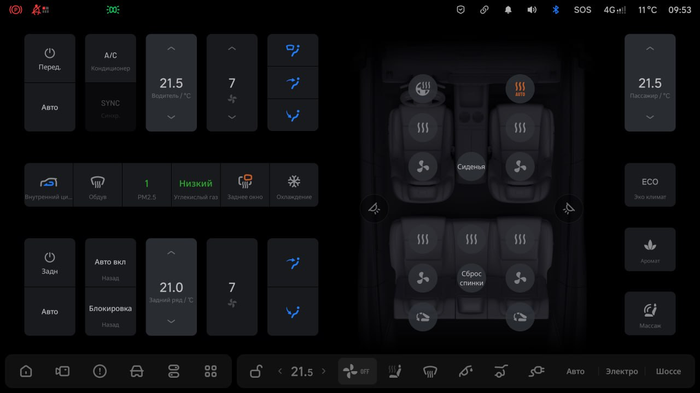

  

<h1 align="center">UnlimAroma</h1>

  

  <a href="#-русский">Русский</a> ·
  <a href="#-english">English</a> ·
  <a href="#-中文">中文</a>

  
  

---

## 🇷🇺 Русский

**UnlimAroma** — приложение для головного устройства **Li Auto**, которое добавляет на экран климата кнопку **«Аромат»** и управляет ароматизатором **Fresh Air** по Bluetooth — так, как будто это штатная функция машины.

### Возможности

- Кнопка «Аромат» встраивается в экран климата (между «Эко климат» и «Массаж») и появляется только когда этот экран открыт.
- Окно управления в стиле штатного меню ароматов Li Auto:
  - интенсивность: Выкл. / Легкий / Средний / Крепкий;
  - три флакона с названием аромата, уровнем остатка и описанием;
  - нажатие на флакон — выбрать аромат; долгое нажатие — сброс остатка после установки нового флакона.
- Иконка кнопки подсвечивается синим, когда ароматизатор включён.
- Дневная и ночная тема (автоматически или вручную).
- Автоподключение к станции и переподключение при потере связи.
- Экран настройки: включение службы, положение кнопки, тема, цикл работа/пауза, поиск и выбор станции.
- Работает на прошивках на русском, английском, китайском и испанском; интерфейс приложения переводится по языку системы.
- После перезагрузки машины служба включается сама.
- В настройках: «О приложении» и поддержка проекта (maib / PayPal по QR).

### Скриншоты

| Экран климата | Окно аромата |
|---|---|
|  |  |

| Настройка (верх) | Настройка (низ) |
|---|---|
|  |  |

### Установка

Нужен компьютер с Windows и USB-кабель с передачей данных.

1. Скачайте `UnlimAroma-<версия>.zip` из раздела [Releases](../../releases) и распакуйте (внутри `aroma-app.apk` и `install.bat`).
2. Машина на P, на машине включена отладка по USB. Подключите кабель.
3. Запустите `install.bat`. В первый раз подтвердите на экране машины «Разрешить отладку по USB».
   Установщик сам поставит приложение, выдаст разрешения и включит службу кнопки — в том числе её автовключение после перезагрузки машины.
4. На машине в UnlimAroma нажмите «Найти станции» и выберите свою «Fresh Air». Перед поиском отключите станцию от телефона (WeChat), иначе её не будет видно.
5. Откройте экран климата — там появится кнопка «Аромат».

Если установщик пишет, что не найден `adb.exe`, скачайте [Android SDK Platform-Tools](https://developer.android.com/tools/releases/platform-tools) для Windows и распакуйте папку `platform-tools` рядом с `install.bat`.
Приложение также можно поставить через установщик UnlimBoostMD.

### Лицензия

© 2026 Alexandru Volovoi. **Все права защищены.** Приложение можно бесплатно устанавливать на свой автомобиль для личного использования. **Запрещено** без письменного разрешения автора копировать, перезаливать, распространять, изменять, встраивать (в том числе декомпилировать), продавать или выдавать приложение за своё. Подробно — в файле [LICENSE](LICENSE).

> Неофициальный проект, не связан с Li Auto. Используйте на свой страх и риск.

---

## 🇬🇧 English

**UnlimAroma** is an app for the **Li Auto** head unit that adds an **"Aroma"** button to the climate screen and controls the **Fresh Air** fragrance station over Bluetooth — so it feels like a built-in feature of the car.

### Features

- The Aroma button is embedded into the climate screen (between "Eco climate" and "Massage") and appears only while that screen is open.
- A control panel styled after the native Li Auto fragrance menu:
  - intensity: Off / Low / Medium / Strong;
  - three vials showing scent name, remaining level and description;
  - tap a vial to select the scent; long-press to reset its level after inserting a new bottle.
- The button icon turns blue while the station is on.
- Day and night themes (follow the system or set manually).
- Auto-connect to the station and reconnect when the link drops.
- Setup screen: service status, button position, theme, work/pause cycle, station scan and selection.
- Works on Russian, English, Chinese and Spanish firmware; the app UI follows the system language.
- The service turns itself back on after the car reboots.
- Settings include an About section with project support (maib / PayPal via QR).

### Screenshots

See the screenshots [above](#-русский) (UI language is Russian).

### Install

You need a Windows PC and a USB data cable.

1. Download `UnlimAroma-<version>.zip` from the [Releases](../../releases) page and unzip it (it contains `aroma-app.apk` and `install.bat`).
2. Put the car in P and enable USB debugging on the head unit. Connect the cable.
3. Run `install.bat`. The first time, confirm "Allow USB debugging" on the car screen.
   The installer installs the app, grants its permissions and enables the button service, including re-enabling it automatically after the car reboots.
4. In UnlimAroma on the car tap "Find stations" and select your "Fresh Air". Disconnect the station from your phone (WeChat) first, otherwise it won't be visible.
5. Open the climate screen — the "Aroma" button is there.

If the installer says `adb.exe` was not found, download [Android SDK Platform-Tools](https://developer.android.com/tools/releases/platform-tools) for Windows and unzip the `platform-tools` folder next to `install.bat`.
The app can also be installed with the UnlimBoostMD installer.

### License

© 2026 Alexandru Volovoi. **All rights reserved.** You may install the app on your own vehicle for personal use free of charge. Copying, re-uploading, redistributing, modifying, reverse-engineering, selling or passing the app off as your own is **prohibited** without the author's written permission. See [LICENSE](LICENSE) for details.

> Unofficial project, not affiliated with Li Auto. Use at your own risk.

---

## 🇨🇳 中文

**UnlimAroma** 是一款用于 **理想汽车（Li Auto）** 车机的应用，它在空调界面中加入 **“香氛”** 按钮，并通过蓝牙控制 **Fresh Air** 香氛机，使用体验如同原厂功能。

### 功能

- “香氛”按钮嵌入空调界面（位于“节能空调”和“按摩”之间），仅在该界面打开时显示。
- 控制面板仿照理想汽车原厂香氛菜单：
  - 浓度：关 / 淡 / 中 / 浓；
  - 三支香氛瓶，显示香型名称、剩余量和说明；
  - 点击香氛瓶切换香型；长按可在更换新瓶后重置剩余量。
- 香氛机开启时，按钮图标变为蓝色。
- 日间 / 夜间主题（跟随系统或手动选择）。
- 自动连接香氛机，断线后自动重连。
- 设置界面：服务状态、按钮位置、主题、工作 / 间歇周期、搜索并选择香氛机。
- 支持俄语、英语、中文和西班牙语固件；应用界面随系统语言切换。
- 车辆重启后服务自动重新启用。
- 设置中包含“关于”及支持项目（maib / PayPal 二维码）。

### 截图

请参见[上方](#-русский)的截图（界面语言为俄语）。

### 安装

需要一台 Windows 电脑和一根支持数据传输的 USB 线。

1. 从 [Releases](../../releases) 页面下载 `UnlimAroma-<版本>.zip` 并解压（内含 `aroma-app.apk` 和 `install.bat`）。
2. 车辆挂 P 挡，在车机上开启 USB 调试，连接数据线。
3. 运行 `install.bat`。首次使用时，请在车机屏幕上确认“允许 USB 调试”。
   安装程序会自动安装应用、授予权限并开启按钮服务，包括车辆重启后自动重新开启。
4. 在车机上打开 UnlimAroma，点击“搜索”，选择你的 “Fresh Air”。搜索前请先断开香氛机与手机（微信）的连接，否则无法搜索到。
5. 打开空调界面，即可看到“香氛”按钮。

如果安装程序提示找不到 `adb.exe`，请下载 Windows 版 [Android SDK Platform-Tools](https://developer.android.com/tools/releases/platform-tools)，并将 `platform-tools` 文件夹解压到 `install.bat` 旁边。
也可以通过 UnlimBoostMD 安装器安装本应用。

### 许可

© 2026 Alexandru Volovoi。**保留所有权利。** 允许免费将本应用安装在您自己的车辆上供个人使用。未经作者书面许可，**禁止**复制、转载、分发、修改、逆向工程、出售本应用或将其冒充为自己的作品。详见 [LICENSE](LICENSE)。

> 非官方项目，与理想汽车无关。使用风险自负。
