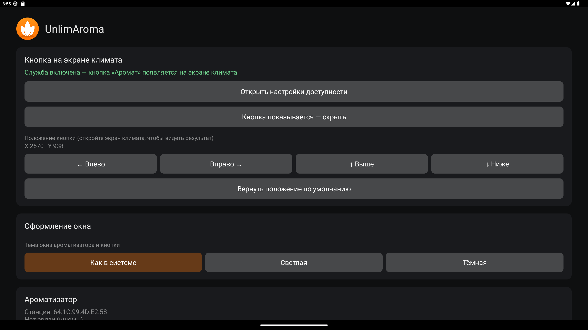
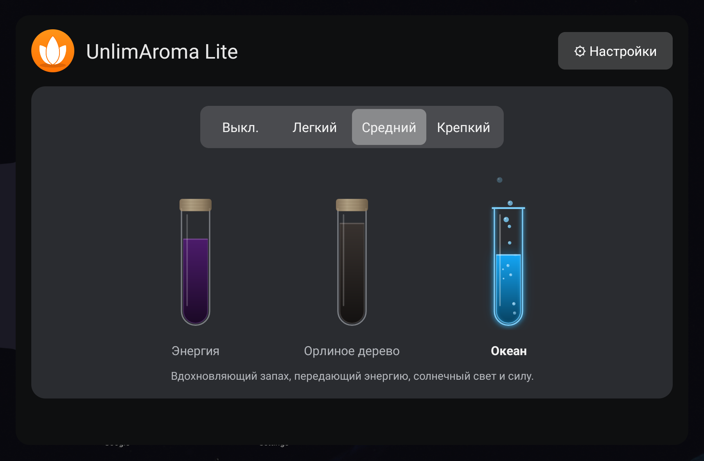
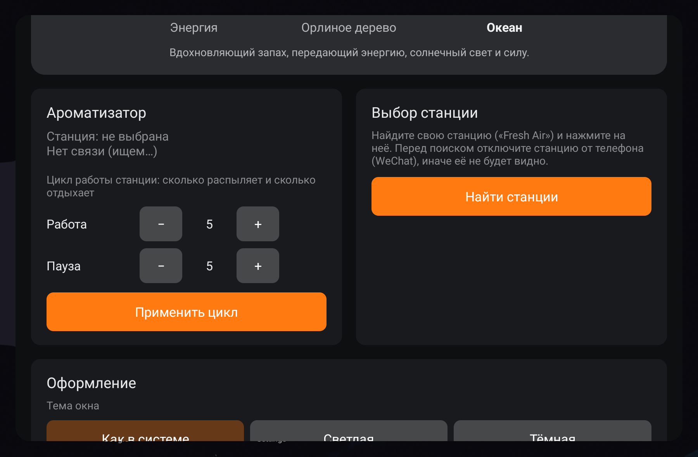
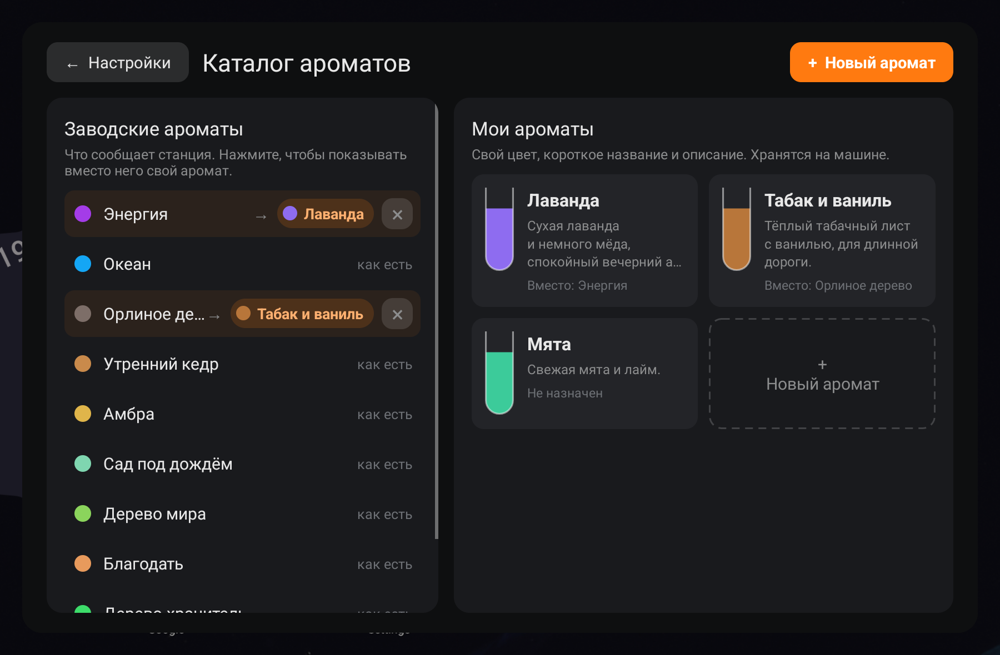
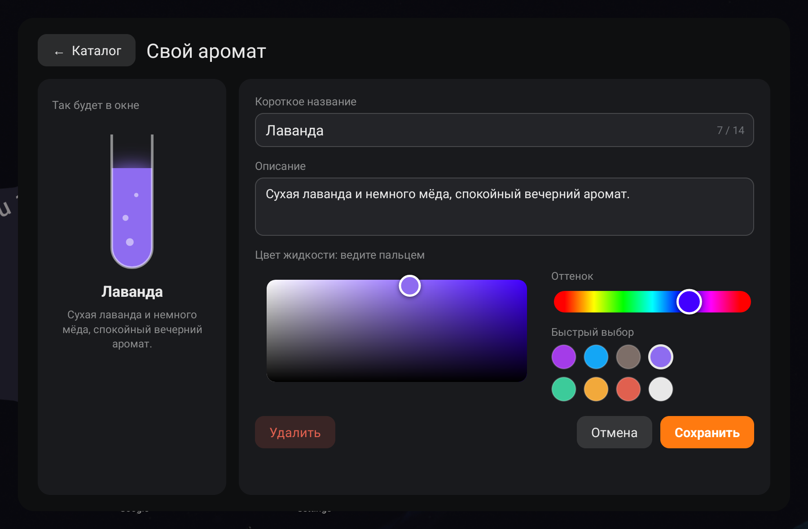
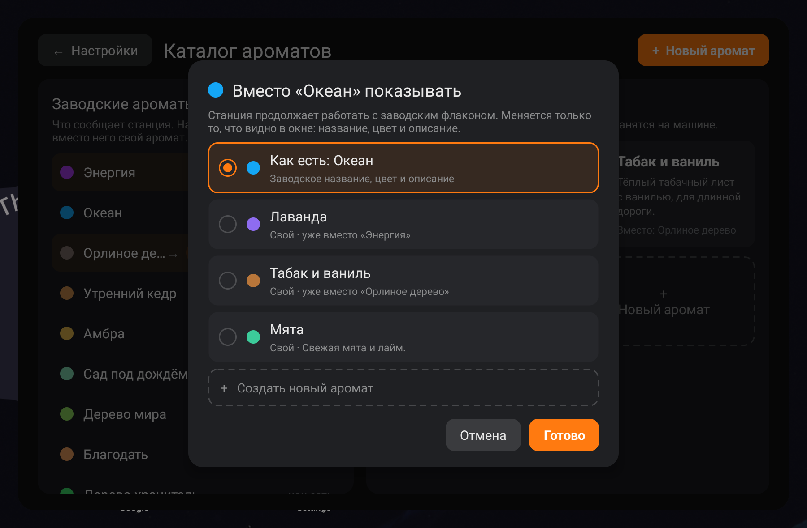
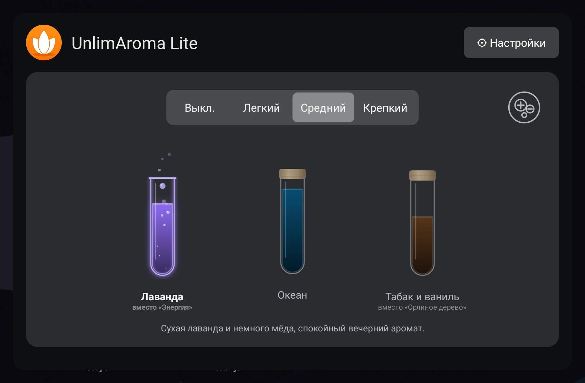

  

<h1 align="center">UnlimAroma</h1>

  

  <a href="#-русский">Русский</a> ·
  <a href="#-english">English</a> ·
  <a href="#-中文">中文</a>

  
  

---

## 🇷🇺 Русский

**UnlimAroma** — приложение для головного устройства **Li Auto**, которое добавляет на экран климата кнопку **«Аромат»** и управляет ароматизатором **Fresh Air** (а также **KS_XFF / BDF_XF**) по Bluetooth — так, как будто это штатная функция машины.

### Возможности

- Кнопка «Аромат» встраивается в экран климата (между «Эко климат» и «Массаж») и появляется только когда этот экран открыт.
- Окно управления в стиле штатного меню ароматов Li Auto:
  - интенсивность: Выкл. / Легкий / Средний / Крепкий;
  - три флакона с названием аромата, уровнем остатка и описанием;
  - нажатие на флакон — выбрать аромат; долгое нажатие — сброс остатка после установки нового флакона.
- Иконка кнопки подсвечивается синим, когда ароматизатор включён.
- Дневная и ночная тема (автоматически или вручную).
- Автоподключение к станции и переподключение при потере связи.
- Два типа ароматизаторов: «Fresh Air» и KS_XFF / BDF_XF (с версии 0.3.0). Тип определяется сам после подключения, окно и кнопки одни и те же. Поддержка KS_XFF / BDF_XF пока не проверена на настоящей станции — если что-то работает не так, пришлите лог `adb logcat -s AROMA` с пометкой, что нажимали.
- Экран настройки: включение службы, положение кнопки, тема, цикл работа/пауза, поиск и выбор станции.
- Работает на прошивках на русском, английском, китайском и испанском; интерфейс приложения переводится по языку системы.
- После перезагрузки машины служба включается сама.
- Каталог ароматов: свои названия, описания и цвета ароматов вместо заводских.
- В настройках: «О приложении» и поддержка проекта (maib / PayPal по QR).

### Скриншоты

| Экран климата | Окно аромата |
|---|---|
|  |  |

| Настройка (верх) | Настройка (низ) |
|---|---|
|  |  |

### UnlimAroma Lite

**UnlimAroma Lite** — версия для тех, кто не хочет давать приложению особых разрешений. Это обычное приложение: оно открывается по значку (его можно закрепить в нижней панели или на рабочем столе) и показывает окно ароматизатора поверх рабочего стола. Кнопки на экране климата в Lite нет.

- Не нужны служба доступности, показ поверх других окон и `WRITE_SECURE_SETTINGS`: только Bluetooth и геолокация (без неё Android не ищет Bluetooth-устройства).
- То же окно ароматизатора: интенсивность, три флакона, сброс остатка. У выбранного аромата флакон открыт и в нём поднимаются пузырьки, чем крепче интенсивность, тем их больше.
- Настройки спрятаны под кнопкой «Настройки»: станция и цикл работы, выбор станции, тема (как в системе / светлая / тёмная).
- Окно закрывается нажатием мимо него или кнопкой «Назад».

На машине может стоять только одна версия, полная или Lite: новая встаёт вместо старой.

| Lite: окно ароматизатора | Lite: настройки |
|---|---|
|  |  |

### Каталог ароматов

С версии 0.4.0, в полной версии и в Lite: «Настройки» → «Каталог ароматов».

- Свои ароматы: короткое название (до 14 символов), описание и цвет жидкости. Цвет выбирается пальцем на палитре (насыщенность, яркость и оттенок) или из быстрых цветов.
- Любой заводской аромат можно показывать как свой: нажмите на него в списке и выберите, что показывать вместо него. Сбросить можно по одному (кнопка ×) или все сразу.
- В окне ароматизатора у флакона своё название, цвет и описание, а мелкой строкой видно, вместо какого аромата он стоит.
- Станция продолжает работать со своим флаконом: меняется только то, что видно в окне. Всё хранится на машине.

| Каталог | Свой аромат |
|---|---|
|  |  |

| Что показывать вместо заводского | Результат в окне |
|---|---|
|  |  |

### Установка

Нужен компьютер с Windows и USB-кабель с передачей данных.

1. Скачайте из раздела [Releases](../../releases) архив нужной версии и распакуйте его: `UnlimAroma-<версия>.zip` — полная, `UnlimAroma-Lite-<версия>.zip` — Lite. Внутри APK и `install.bat`.
2. Машина на P, на машине включена отладка по USB. Подключите кабель.
3. Запустите `install.bat`. В первый раз подтвердите на экране машины «Разрешить отладку по USB».
   Для полной версии установщик сам поставит приложение, выдаст разрешения и включит службу кнопки — в том числе её автовключение после перезагрузки машины. Lite он просто ставит и открывает.
4. На машине в UnlimAroma нажмите «Найти станции» (в Lite — сначала «Настройки») и выберите свою станцию: «Fresh Air», KS_XFF или BDF_XF. Перед поиском отключите станцию от телефона (WeChat), иначе её не будет видно.
5. Полная версия: откройте экран климата — там появится кнопка «Аромат». Lite: открывайте приложение по значку.

Если установщик пишет, что не найден `adb.exe`, скачайте [Android SDK Platform-Tools](https://developer.android.com/tools/releases/platform-tools) для Windows и распакуйте папку `platform-tools` рядом с `install.bat`.
Приложение также можно поставить через установщик UnlimBoostMD.

### Лицензия

© 2026 Alexandru Volovoi. **Все права защищены.** Приложение можно бесплатно устанавливать на свой автомобиль для личного использования. **Запрещено** без письменного разрешения автора копировать, перезаливать, распространять, изменять, встраивать (в том числе декомпилировать), продавать или выдавать приложение за своё. Подробно — в файле [LICENSE](LICENSE).

> Неофициальный проект, не связан с Li Auto. Используйте на свой страх и риск.

---

## 🇬🇧 English

**UnlimAroma** is an app for the **Li Auto** head unit that adds an **"Aroma"** button to the climate screen and controls the **Fresh Air** fragrance station (and **KS_XFF / BDF_XF** units) over Bluetooth — so it feels like a built-in feature of the car.

### Features

- The Aroma button is embedded into the climate screen (between "Eco climate" and "Massage") and appears only while that screen is open.
- A control panel styled after the native Li Auto fragrance menu:
  - intensity: Off / Low / Medium / Strong;
  - three vials showing scent name, remaining level and description;
  - tap a vial to select the scent; long-press to reset its level after inserting a new bottle.
- The button icon turns blue while the station is on.
- Day and night themes (follow the system or set manually).
- Auto-connect to the station and reconnect when the link drops.
- Two kinds of fragrance units: "Fresh Air" and KS_XFF / BDF_XF (since 0.3.0). The kind is detected after connecting; the window and buttons are the same. KS_XFF / BDF_XF support has not been checked on a real unit yet; if something is wrong, please send `adb logcat -s AROMA` with a note of what you tapped.
- Setup screen: service status, button position, theme, work/pause cycle, station scan and selection.
- Works on Russian, English, Chinese and Spanish firmware; the app UI follows the system language.
- The service turns itself back on after the car reboots.
- Scent catalog: your own scent names, descriptions and colours in place of the factory ones.
- Settings include an About section with project support (maib / PayPal via QR).

### Screenshots

See the screenshots [above](#-русский) (UI language is Russian).

### UnlimAroma Lite

**UnlimAroma Lite** is for those who don't want to give the app any special permissions. It is a regular app: open it from its icon (you can pin it to the dock or the home screen) and it shows the fragrance window over the home screen. Lite has no button on the climate screen.

- No accessibility service, no drawing over other apps, no `WRITE_SECURE_SETTINGS`: only Bluetooth and location (Android needs location to scan for Bluetooth devices).
- The same fragrance window: intensity, three vials, level reset. The selected vial is open with bubbles rising in it; the stronger the intensity, the more bubbles.
- Settings are behind the "Settings" button: station and work cycle, station choice, theme (system / light / dark).
- Close the window by tapping outside it or with Back.

A car can have only one version, full or Lite: the new one replaces the old one.

Screenshots of Lite are [above](#unlimaroma-lite).

### Scent catalog

Since 0.4.0, in both the full version and Lite: "Settings" → "Scent catalog".

- Your own scents: a short name (up to 14 characters), a description and a liquid colour, picked with a finger on a palette (saturation, brightness and hue) or from quick colours.
- Any factory scent can be shown as one of yours: tap it in the list and choose what to show instead. Reset them one by one (× button) or all at once.
- In the fragrance window the vial shows your name, colour and description, with a small line saying which scent it stands in for.
- The unit keeps using its own bottle; only what the window shows changes. Everything is kept on the car.

See the screenshots [above](#каталог-ароматов) (UI language is Russian).

### Install

You need a Windows PC and a USB data cable.

1. Download the archive of the version you want from the [Releases](../../releases) page and unzip it: `UnlimAroma-<version>.zip` is the full version, `UnlimAroma-Lite-<version>.zip` is Lite. It contains the APK and `install.bat`.
2. Put the car in P and enable USB debugging on the head unit. Connect the cable.
3. Run `install.bat`. The first time, confirm "Allow USB debugging" on the car screen.
   For the full version the installer installs the app, grants its permissions and enables the button service, including re-enabling it automatically after the car reboots. Lite is simply installed and opened.
4. In UnlimAroma on the car tap "Find stations" (in Lite open "Settings" first) and select your station: "Fresh Air", KS_XFF or BDF_XF. Disconnect the station from your phone (WeChat) first, otherwise it won't be visible.
5. Full version: open the climate screen — the "Aroma" button is there. Lite: open the app from its icon.

If the installer says `adb.exe` was not found, download [Android SDK Platform-Tools](https://developer.android.com/tools/releases/platform-tools) for Windows and unzip the `platform-tools` folder next to `install.bat`.
The app can also be installed with the UnlimBoostMD installer.

### License

© 2026 Alexandru Volovoi. **All rights reserved.** You may install the app on your own vehicle for personal use free of charge. Copying, re-uploading, redistributing, modifying, reverse-engineering, selling or passing the app off as your own is **prohibited** without the author's written permission. See [LICENSE](LICENSE) for details.

> Unofficial project, not affiliated with Li Auto. Use at your own risk.

---

## 🇨🇳 中文

**UnlimAroma** 是一款用于 **理想汽车（Li Auto）** 车机的应用，它在空调界面中加入 **“香氛”** 按钮，并通过蓝牙控制 **Fresh Air** 香氛机（以及 **KS_XFF / BDF_XF** 香氛机），使用体验如同原厂功能。

### 功能

- “香氛”按钮嵌入空调界面（位于“节能空调”和“按摩”之间），仅在该界面打开时显示。
- 控制面板仿照理想汽车原厂香氛菜单：
  - 浓度：关 / 淡 / 中 / 浓；
  - 三支香氛瓶，显示香型名称、剩余量和说明；
  - 点击香氛瓶切换香型；长按可在更换新瓶后重置剩余量。
- 香氛机开启时，按钮图标变为蓝色。
- 日间 / 夜间主题（跟随系统或手动选择）。
- 自动连接香氛机，断线后自动重连。
- 支持两种香氛机：“Fresh Air” 和 KS_XFF / BDF_XF（自 0.3.0 起）。连接后自动识别类型，窗口和按钮相同。KS_XFF / BDF_XF 的支持尚未在实机上验证；如有异常，请发送 `adb logcat -s AROMA` 日志并注明当时的操作。
- 设置界面：服务状态、按钮位置、主题、工作 / 间歇周期、搜索并选择香氛机。
- 支持俄语、英语、中文和西班牙语固件；应用界面随系统语言切换。
- 车辆重启后服务自动重新启用。
- 香氛目录：用自定义的名称、描述和颜色替代原厂香氛的显示。
- 设置中包含“关于”及支持项目（maib / PayPal 二维码）。

### 截图

请参见[上方](#-русский)的截图（界面语言为俄语）。

### UnlimAroma Lite

**UnlimAroma Lite** 适合不想给应用任何特殊权限的用户。它是一个普通应用：点击图标打开（可固定到底部栏或桌面），在桌面上方显示香氛窗口。Lite 不在空调界面中添加按钮。

- 不需要无障碍服务、悬浮窗和 `WRITE_SECURE_SETTINGS`，只需要蓝牙和定位（安卓需要定位权限才能搜索蓝牙设备）。
- 相同的香氛窗口：浓度、三支香氛瓶、余量重置。选中的香氛瓶会打开并冒出气泡，浓度越高气泡越多。
- 设置收在“设置”按钮下：香氛机与工作周期、选择香氛机、主题（跟随系统 / 浅色 / 深色）。
- 点击窗口外部或按返回键关闭窗口。

车上只能安装其中一个版本（完整版或 Lite），新安装的会替换旧的。

Lite 的截图见[上方](#unlimaroma-lite)。

### 香氛目录

自 0.4.0 起，完整版和 Lite 均可使用：“设置” → “香氛目录”。

- 自定义香氛：简称（最多 14 个字符）、描述和液体颜色。颜色可用手指在调色板上选择（饱和度、亮度和色相），也可使用快捷颜色。
- 任意原厂香氛都可显示为自定义香氛：在列表中点击它，选择替代显示的香氛。可逐个恢复（× 按钮）或全部恢复。
- 香氛窗口中的香氛瓶会显示自定义的名称、颜色和描述，并用一行小字注明它替代的是哪种香氛。
- 香氛机仍使用原有香氛瓶，只改变窗口中的显示。所有内容保存在车机上。

截图见[上方](#каталог-ароматов)（界面语言为俄语）。

### 安装

需要一台 Windows 电脑和一根支持数据传输的 USB 线。

1. 从 [Releases](../../releases) 页面下载所需版本的压缩包并解压：`UnlimAroma-<版本>.zip` 为完整版，`UnlimAroma-Lite-<版本>.zip` 为 Lite。内含 APK 和 `install.bat`。
2. 车辆挂 P 挡，在车机上开启 USB 调试，连接数据线。
3. 运行 `install.bat`。首次使用时，请在车机屏幕上确认“允许 USB 调试”。
   完整版：安装程序会自动安装应用、授予权限并开启按钮服务，包括车辆重启后自动重新开启。Lite：仅安装并打开应用。
4. 在车机上打开 UnlimAroma，点击“搜索”（Lite 需先打开“设置”），选择你的香氛机：“Fresh Air”、KS_XFF 或 BDF_XF。搜索前请先断开香氛机与手机（微信）的连接，否则无法搜索到。
5. 完整版：打开空调界面，即可看到“香氛”按钮。Lite：点击图标打开应用。

如果安装程序提示找不到 `adb.exe`，请下载 Windows 版 [Android SDK Platform-Tools](https://developer.android.com/tools/releases/platform-tools)，并将 `platform-tools` 文件夹解压到 `install.bat` 旁边。
也可以通过 UnlimBoostMD 安装器安装本应用。

### 许可

© 2026 Alexandru Volovoi。**保留所有权利。** 允许免费将本应用安装在您自己的车辆上供个人使用。未经作者书面许可，**禁止**复制、转载、分发、修改、逆向工程、出售本应用或将其冒充为自己的作品。详见 [LICENSE](LICENSE)。

> 非官方项目，与理想汽车无关。使用风险自负。
